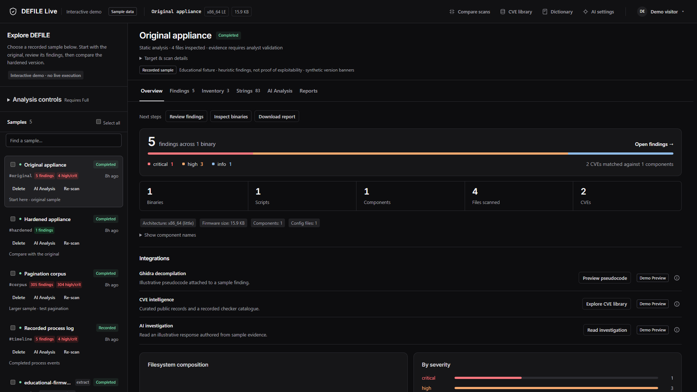
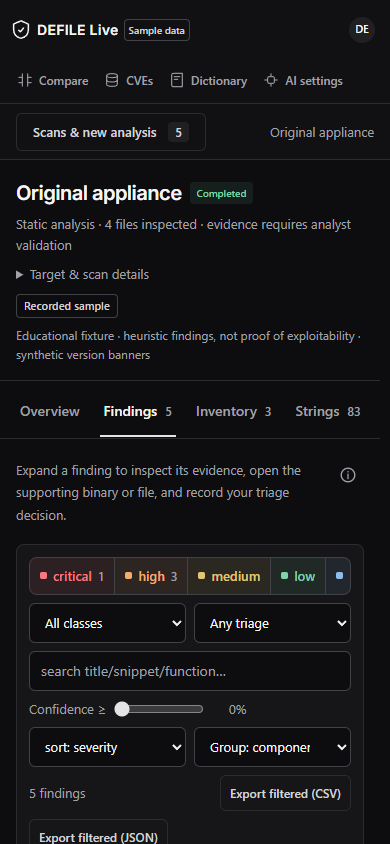

# DEFILE

**Firmware reverse engineering and security analysis workbench.**

DEFILE extracts supported firmware containers, inspects Linux ELF binaries and
filesystems, identifies potential security weaknesses, and organizes evidence for
investigation. Static detections are research leads, not proof of exploitability.

**[Explore DEFILE Live](https://defile-demo.austinbc.dev/)** ·
[Full installation](#install-defile-full) · [Demo guide](LIVE_DEMO.md) ·
[Environment and integrations](ENVIRONMENT.md) · [Settings](SETTINGS.md) ·
[CLI](CLI.md) · [Troubleshooting](TROUBLESHOOTING.md) · [Documentation map](docs/README.md)

## Full and Live

| Capability | DEFILE Full | DEFILE Live |
|---|---|---|
| Access | Self-hosted, authenticated workbench | Public interactive demo; no account |
| Analysis | Real Python engine and Go job service | Sanitized, precomputed engine results |
| Findings/evidence | Real inputs, filters, triage and saved reports | Search, filters, pagination and recorded evidence |
| Binary/function inspection | Metadata from actual analysis | Same views using educational samples |
| Firmware extraction | Optional Moria installation | Genuine recorded extraction regions |
| Comparison/downloads | Stored scans; JSON, Markdown and CycloneDX | Local sample comparison and real static downloads |
| Ghidra | Optional headless enrichment and compatible JDK | Clearly labelled illustrative pseudocode |
| CVE intelligence | Bundled references and configured scanner feeds | Curated records and recorded checker catalogue |
| AI investigation | Configured provider; may incur provider charges | Authored illustrations; no live inference |
| Upload/execution | Available on the self-hosted server | Unavailable; controls explain the boundary |

Use Full for firmware you own or are authorized to assess. Live needs only a
browser and never connects to a private Full installation.

## The workspace

These screenshots show Live's public educational records, sanitized paths and
explicit demonstration disclosures. They contain no private runtime evidence.

| Desktop overview | Mobile investigation |
|---|---|
|  |  |

Choose a scan/sample, review **Overview**, expand **Findings**, then open supporting
binary/function or file evidence. Return controls retain your context. **Inventory**,
**Strings**, **AI Analysis** and **Reports** expose deeper views and full downloads.
Findings also exports filtered CSV and JSON.

## Capabilities and limits

- ELF disassembly, imported-call resolution and function recovery across supported
  x86, ARM/Thumb, AArch64 and MIPS architectures.
- Binary protections, filesystem/configuration hardening, script checks and
  sensitive-data rules with evidence and confidence values.
- Heuristic taint/reachability and cross-binary candidate paths for analyst review.
- Component/version detection, CVE correlation, static service inference,
  BusyBox inventory, file previews and extracted strings.
- Real job progress, comparisons, triage history and report generation.

See [requirements](firmware-analysis-requirements.md) and [environment limits](ENVIRONMENT.md).
Stripped code and missing metadata limit recovery; vendor backports affect version
matching. Port numbers are static inferences, not live network probes. The main
binary analysis path supports ELF; Windows PE and macOS Mach-O need additional
support. Dynamic emulation and a standalone interactive call-graph viewer are not
implemented. No scanner guarantees exhaustive discovery or exploitability.

## Install DEFILE Full

Use Linux or macOS; Windows requires WSL2. Use a native Linux filesystem for
accurate Linux permission checks. The service uses POSIX process groups.

On Debian/Ubuntu, install the virtual-environment support and basic build tools:

```bash
sudo apt-get update
sudo apt-get install python3-venv python3-pip gcc git
```

Prerequisites: **Python 3.10+** (3.12 is a suitable baseline), **Go 1.25+**, and the
Python dependencies in `pyproject.toml`: Capstone, pyelftools, cve-bin-tool,
cryptography and Pillow. GCC is needed for compiled regression fixtures, not
ordinary analysis. See [ENVIRONMENT.md](ENVIRONMENT.md) for system packages.

```bash
git clone https://github.com/xinatra99/DEFILE.git
cd DEFILE
python3 -m venv .venv
. .venv/bin/activate
python3 -m pip install -e .
cd service
go build -o defile-service .
cd ..
sh service/start.sh
```

Open **http://localhost:8080**. A fresh installation prints its generated `admin`
password in the startup log. After login, use **User center → Change password**.
Keep the same `service/.data` directory across restarts/upgrades. Credentials,
provider encryption keys, uploads and reports belong to that private installation.
Never commit or deploy its runtime. Password recovery is administrator-managed;
see [service authentication](service/README.md) and [upgrading](UPGRADING.md).
Follow [First investigation](USAGE.md) for a harmless trial, evidence review,
triage and report downloads.

Keep the virtual environment active when starting Full so `python3` resolves the
engine. The launcher binds to loopback. For CLI-only analysis:

```bash
python3 -m defile.cli analyze /path/to/extracted-rootfs --json report.json --md report.md --sbom sbom.json
```

In the UI, enter a path on the **analysis server**, or upload a binary. Uploading
immediately submits analysis. For packed firmware, use **Extract firmware**, inspect
usable regions and choose **Start analysis**. DEFILE does not execute the firmware.

## Optional integrations

**Moria extraction:** source/binaries are external. Use the complete
[pinned source build and extraction check](ENVIRONMENT.md#moria-extraction),
including codec dependencies, executable discovery and restart instructions.
No Git submodule is required; a specific compatible commit is documented.

```bash
export DEFILE_MORIA=/absolute/path/to/moria
sh service/start.sh
```

**Ghidra:** install Ghidra and the full JDK required by that release, set
`GHIDRA_HOME` or expose `analyzeHeadless` on PATH, then enable enrichment in
**Analysis options** before a new scan. See the
[official installation guide](https://github.com/NationalSecurityAgency/ghidra#install).
Live does not run Ghidra.

**CVE feeds:** installing cve-bin-tool does not populate its advisory database.
Follow its [official documentation](https://cve-bin-tool.readthedocs.io/) and
[DEFILE setup notes](ENVIRONMENT.md). Feed updates can require network access,
storage/time and provider-specific configuration. The bundled reference set is
small and not comprehensive. To deliberately use bundled correlation offline:

```bash
export DEFILE_DISABLE_CVE_BIN_TOOL=1
sh service/start.sh
```

**AI:** open **AI settings**, configure a compatible endpoint, API key and model,
then use **AI Analysis** on a completed scan. Selected evidence is sent to that
provider; access and pricing are separate. Keys use the private runtime encryption
key. Ordinary static analysis requires no AI provider.

Optional YARA rules use `yara-python`. CUDA chart rendering uses optional CuPy
and falls back to CPU. Neither is required for Live.

## Build and preview Live

Requirements: Node.js 24.x and npm for the pinned release build. The source uses
Node 20+ APIs; this release selects Node 24.x for reproducibility and has no npm dependencies.
Sanitized recordings are committed; normal builds need no Python or Go.

```bash
npm ci --ignore-scripts
npm run build
npm run preview
```

Open **http://localhost:8081**. Output: **dist/live**. Navigation, filtering,
comparison, previews and exports operate on immutable bundled data. Recorded
process/extraction views, illustrative Ghidra/AI content and curated CVEs carry
labels and hover/focus/touch explanations. Execution and persistent changes require Full.

The educational binaries use synthetic OpenSSL banners to exercise matching;
OpenSSL and vendor firmware are not bundled. These are not real-world vulnerability
discoveries. See [provenance](demo/README.md), [fixture source](demo/fixtures/probe.c)
and [manifest](demo/data/manifest.json) for generation, sanitization and refresh.

## Development and testing

```bash
npm run build
node --test tests/*.test.mjs
. .venv/bin/activate
python3 -m pip install pytest
python3 -m pytest tests -q
cd service
go test ./...
go vet ./...
```

Cross-architecture tests require matching cross-compilers. Live Ghidra and
populated-feed tests need their optional configuration; skips are not passes.
[RELEASE.md](RELEASE.md) records the actual clean-checkout, regression and public
production checks and any outstanding limitations. The complete
[upstream installation comparison](UPSTREAM_AUDIT.md) records preserved behavior,
intentional differences and corrected instructions.

## Deployment

Vercel project **defile-demo** builds this independent repository using **Other**,
`npm run build`, and output **dist/live**. Only the static demo is published.
Full's Go/Python source remains available for self-hosting, with no public execution
backend. Live needs no environment secrets or paid inference service. The Git
integration builds future approved production-branch pushes. See [LIVE_DEMO.md](LIVE_DEMO.md).

## License and attribution

DEFILE is a modified distribution of **IFDA (IoT Firmware Deep Analysis)**:
[cn0xroot/IFDA](https://github.com/cn0xroot/IFDA). Original copyright notices,
required attribution and modification details remain in [NOTICE](NOTICE).
The project retains [Apache License 2.0](LICENSE).

Dependencies retain their own licenses. Bundled Alpine.js is MIT; Inter includes
its OFL notice. External Moria is MIT and Ghidra is Apache-2.0. cve-bin-tool is
GPL-3.0 and installed separately; it is not vendored into this repository or Live.
Preserve dependency notices when redistributing installed applications/assets.
Acknowledgment is retained for [EMBA](https://github.com/e-m-b-a/emba), whose approach
to CVE correlation and sensitive-data research informed the supplied implementation,
and the cve-bin-tool and Moria projects.
